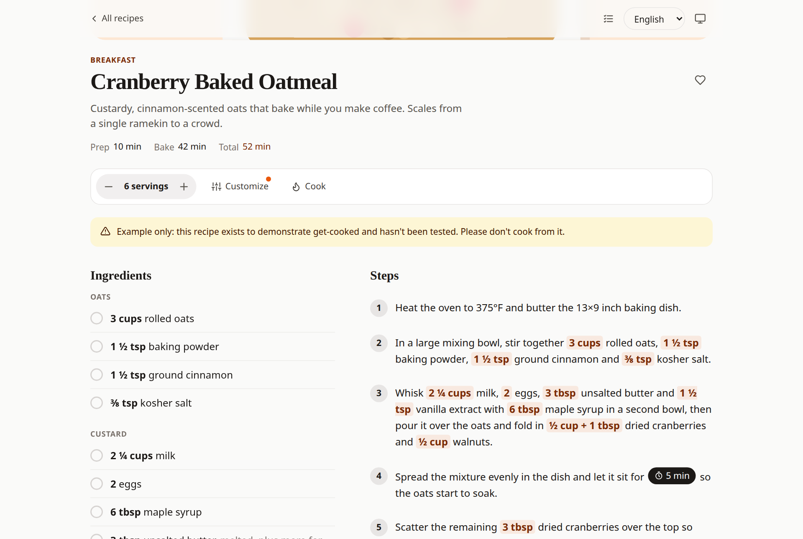
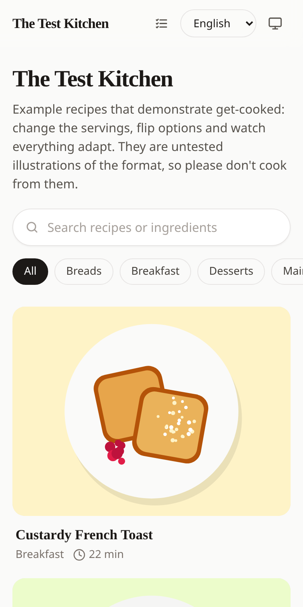
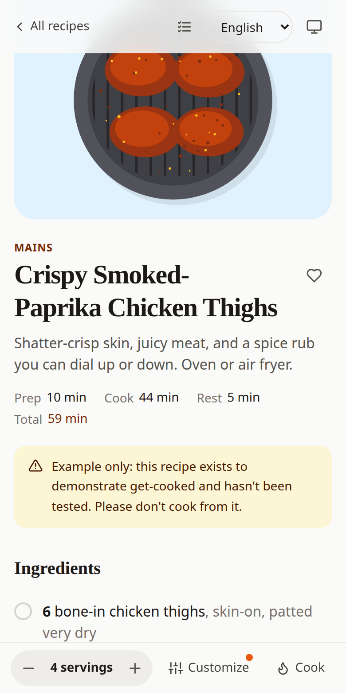
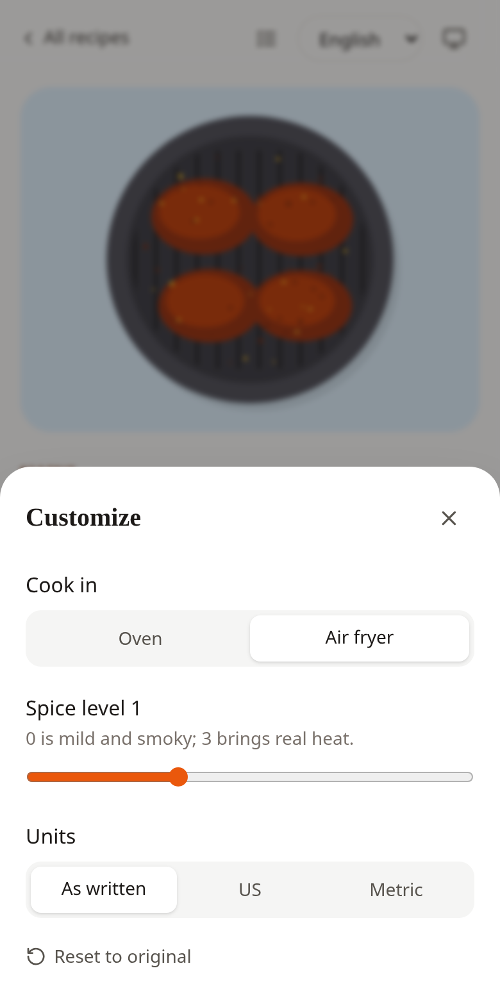
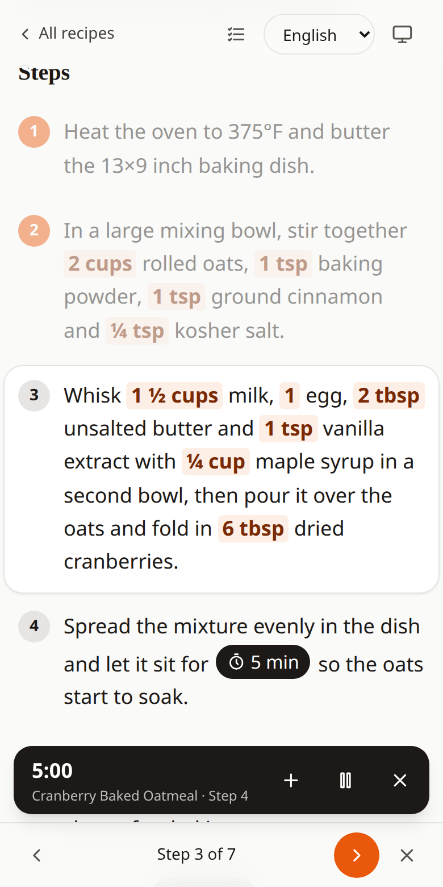
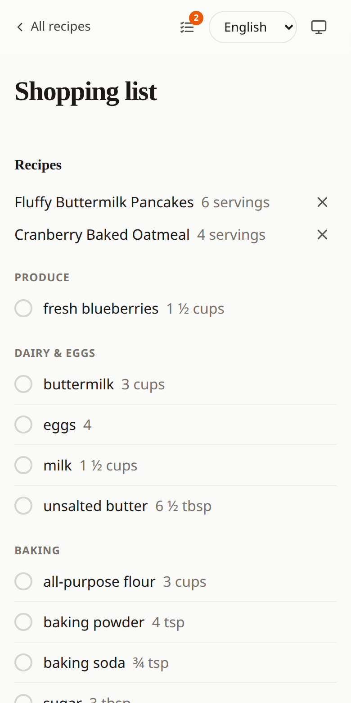

# get-cooked

> [!WARNING]
> This project was written by AI (Claude) under my direction. Use it with
> caution, and only after inspecting the code in this repository yourself.
> The only things tested are the features I rely on in my own use of this
> tool, and I don't guarantee fixes for issues anyone else runs into. You're
> free to fork it or contribute (see [Contributing](#contributing)); I'll
> merge changes in as I'm able to review them.

**Recipes that think.** get-cooked turns a folder of YAML recipes into a fast,
mobile-first recipe website where everything adapts to the reader: change the
servings and amounts, pans, times and even steps update; flip an option
("add cranberries", "air fryer instead of oven", "dairy-free") and the recipe
rewrites itself.

It's a single Go binary with no runtime dependencies, designed to run in
GitHub Actions and publish to GitHub Pages (or any static host).

The recipes in the screenshots and in [examples/site](examples/site) are
**examples only**: untested illustrations of the format. Please don't cook
from them.

<p align="center">
  <picture><source media="(prefers-color-scheme: dark)" srcset="docs/screenshots/desktop-dark.png"></picture>
</p>

<p align="center">
  <picture><source media="(prefers-color-scheme: dark)" srcset="docs/screenshots/index-dark.png"></picture>
  <picture><source media="(prefers-color-scheme: dark)" srcset="docs/screenshots/recipe-dark.png"></picture>
  <picture><source media="(prefers-color-scheme: dark)" srcset="docs/screenshots/customize-dark.png"></picture>
  <picture><source media="(prefers-color-scheme: dark)" srcset="docs/screenshots/cook-dark.png"></picture>
  <picture><source media="(prefers-color-scheme: dark)" srcset="docs/screenshots/list-dark.png"></picture>
</p>

```yaml
title: Cranberry Baked Oatmeal
servings: { default: 4, min: 1, max: 12 }
vars:
  bake: "servings <= 2 ? 25 : 30 + servings * 2"
equipment:
  - id: dish
    name: "{if servings <= 2}8×8 inch baking dish{else}13×9 inch baking dish{end}"
ingredients:
  - { id: oats, ingredient: rolled-oats, amount: 2, unit: cup }
  - { id: cranberries, ingredient: dried-cranberries, amount: 0.5, unit: cup, optional: true }
steps:
  - Heat the oven to {375 | temp} and butter the &dish.
  - Stir @oats{if cranberries} and @cranberries{3/4}{end} into the custard.
  - when: cranberries
    text: Scatter the remaining @cranberries{1/4} on top.
  - Bake ~{bake}.
notes:
  - when: servings == 1
    kind: warning
    text: A single serving may come out softer.
```

## Features

**Recipe language**
- Arbitrary math in amounts, times and text (`30 + servings * 2`), with
  variables and conditions on any ingredient, step, note, section or tool.
- Reader options: toggles, choices and number sliders that add, remove or
  rewrite ingredients and steps. `optional: true` ingredients get a checkbox
  automatically.
- Variants: `butter` *or* `olive oil` under one id, so steps don't care.
- Inline conditionals `{if}…{elif}…{else}…{end}`, ingredient references with
  live amounts (`@flour`, `@sugar{1/2}`, `@salt.topping`), equipment
  references (`&pan`) and tap-to-start timers (`~{25}`).
- Divided ingredients: one total in the list, each step's share underneath.
- Ranges: `amount: [2, 3]` → "2–3 cloves", scaled and converted.
- Image variants: the recipe photo can change with the options (the air
  fryer version, the blueberry version) while the index keeps the default.
- Recipe references: "¾ loaf sandwich bread" links to the bread recipe at the
  right number of loaves, with options passed through.

**Quantities**
- Shared ingredient database with densities, so cups ⇄ grams just works.
- Unit systems: as written, US or metric, chosen by the reader.
- Friendly rounding with configurable ladders: 15/64 tsp → ¼ tsp,
  0.125 cup → 2 tbsp, 0.875 cup → ¾ cup + 2 tbsp, eggs stay whole.

**Site**
- Mobile first, uncrowded, light and dark mode, prints cleanly, works without
  JavaScript, and works offline once visited (PWA).
- Cook mode keeps the screen awake and turns the bottom bar into
  ‹ Step 3 of 7 › navigation (arrow keys and space work too). Timers survive
  reloads and ring with sound, vibration and notifications.
- Shopping list: add recipes as configured; the list merges the same
  ingredient across recipes (converting units), groups it by aisle and
  remembers what you've ticked off. Everything stays on the device.
- Export the recipe exactly as configured: print or save as PDF (a clean
  cookbook-style layout), download Markdown, or copy as text.
- Tap any amount to scale the recipe to what you have ("I have 3 eggs").
- Saved recipes (♥) with an index filter, and private per-recipe notes.
- Instant search, category filters, shareable links that keep servings and
  options, schema.org structured data, sitemaps, Atom feed and responsive
  images.
- Multiple languages for both UI and recipes, with a language picker. Recipes
  that aren't translated fall back to the original.

**Tooling**
- `get-cooked validate` checks every recipe across all servings, options and
  unit systems, with `file:line` errors (and GitHub annotations).
- Claude Code skills to import recipes from the web, translate them, add
  languages and draw matching illustrations.

## Install

Download a binary from the [releases](https://github.com/RashKash103/get-cooked/releases)
page, or install with Go (1.27+):

```sh
go install github.com/RashKash103/get-cooked/cmd/get-cooked@latest
```

To build from source (Go 1.27+, Node 24+, pnpm):

```sh
git clone https://github.com/RashKash103/get-cooked && cd get-cooked
make build          # → bin/get-cooked
```

## Quick start

```sh
get-cooked init my-recipes && cd my-recipes
get-cooked serve                  # http://localhost:8080, live reload
get-cooked new "Lemon Bars" -c desserts
get-cooked validate
get-cooked build                  # → ./public
```

A site looks like this:

```
my-recipes/
  get-cooked.yaml        site config (title, base_url, languages, units, theme)
  ingredients.yaml       ingredient database (names, densities, rounding)
  recipes/
    desserts/lemon-bars.yaml
    desserts/lemon-bars.jpg
    desserts/lemon-bars.es.yaml   optional translation
  i18n/es.yaml           optional UI translation
  static/                copied as-is (favicon, CNAME…)
```

The full recipe reference is [docs/recipe-format.md](docs/recipe-format.md)
(also available offline: `get-cooked docs`). For editor autocomplete, start
recipes with
`# yaml-language-server: $schema=https://raw.githubusercontent.com/RashKash103/get-cooked/main/schema/recipe.schema.json`.

## Commands

| Command | Purpose |
|---|---|
| `init [dir]` | Create a site (config, ingredient DB, example recipe, Pages workflow) |
| `new <title>` | Create a recipe file |
| `serve` | Preview with live reload |
| `validate` | Check everything (`--format github` for annotations, `--strict` for unit-conversion gaps) |
| `build` | Write the static site (`--base-url`, `--drafts`) |
| `render <file>` | Print a recipe for a state: `--servings 2 --set vegan=true --units metric --lang es [--json]` |
| `export <file>` | Markdown, text, Typst or PDF (via [Typst](https://typst.app)) for a state: `-f pdf --servings 2 --paper us-letter` |
| `import <url>` | Draft a recipe from a page's schema.org data |
| `i18n init/extract/status` | Manage UI and recipe translations |
| `skills install/list` | Install the Claude Code skills |
| `docs`, `schema` | Print the format reference or a JSON Schema |

## Publish with GitHub Actions

`get-cooked init` writes this workflow for you:

```yaml
- uses: actions/checkout@v4
- id: pages
  uses: actions/configure-pages@v5
- uses: RashKash103/get-cooked@v0
  with:
    version: latest            # or pin, e.g. 0.3.0
    base-url: ${{ steps.pages.outputs.base_url }}/
- uses: actions/upload-pages-artifact@v3
  with:
    path: public
```

See [docs/github-actions.md](docs/github-actions.md) for other hosts and
options.

## Languages

```yaml
# get-cooked.yaml
languages: [en, es]   # first = the language recipes are written in
```

- `get-cooked i18n init es` creates `i18n/es.yaml` with every UI string,
  unit name and ingredient name to translate (plus decimal separator, the
  "de" in "2 tazas de harina", and a default unit system).
- Numbers can use the language's own digits (`digits: arab` → ٢, `deva` →
  २, `arabext`, `thai`, `beng`, … or any ten characters). Fractions follow
  with `fractions: native` (the language's numerals around a fraction slash:
  ٢ ١⁄٢), and `fraction_glyphs: { "1/2": "½" }` sets your own character for
  any fraction. Quantities, times, temperatures, step numbers, timers and
  exports all follow it.
- `get-cooked i18n extract --lang es` creates `<recipe>.es.yaml` files mapping
  each original sentence to its translation. Logic stays in the original
  recipe; untranslated strings fall back to the original language, and
  `validate` reports missing and stale ones.
- Spanish pages live under `/es/`. The picker appears only with two or more
  languages and remembers the choice on the device.

## Claude Code skills

```sh
get-cooked skills install           # into ./.claude/skills (asks first)
```

- **import-recipe**: URL, text or photo → a polished recipe with scaling logic
  and options.
- **recipe-illustration**: a flat SVG of the dish in the site's style.
- **add-site-language** / **translate-recipe**: translations.

Release builds install the skills published with that release; development
builds use `main`.

## Timers on phones

Browsers can't create timers in a phone's Clock app, so get-cooked runs its own
timers: they persist across reloads and pages, ring with sound and vibration,
and send a notification when allowed. Installed as a PWA on iOS 16.4+,
notifications work there too. Opt-in extras in `get-cooked.yaml`:

```yaml
timers:
  android_intent: true        # "open in Clock app" button on Android (experimental)
  ios_shortcut: Start Timer   # runs a Shortcut you create that takes seconds as input
```

A future native wrapper app can take over timers and screen wake by injecting
`window.GetCookedNative = { setTimer(seconds, label), keepScreenOn(on) }`.

## Documentation

| Document | What's in it |
|---|---|
| [docs/recipe-format.md](docs/recipe-format.md) | The complete recipe language: options, expressions, templates, variants, ranges, divided ingredients, recipe references, image variants, translations and the ingredient database (also `get-cooked docs`) |
| [docs/github-actions.md](docs/github-actions.md) | Building and deploying a site in CI (GitHub Pages and other hosts) |
| [docs/design.md](docs/design.md) | Architecture: how the compiler, the two runtimes and the site builder fit together |
| [skills/README.md](skills/README.md) | The Claude Code skills and how to install them |
| [examples/site](examples/site) | A complete example site (English and Spanish). Its recipes are untested illustrations of the format; don't cook from them |
| [schema/](schema) | JSON Schemas for recipes, the ingredient database, site config and UI translations (also `get-cooked schema`) |
| [docs/STATUS.md](docs/STATUS.md) | What's done and ideas for later |
| [CONTRIBUTING.md](CONTRIBUTING.md) | Development setup and how to contribute |

## Development

```sh
make deps        # pnpm install
make build       # frontend bundle + binary
make test        # Go (race) + TypeScript unit and conformance tests
make e2e         # Playwright, mobile + desktop, against the real binary
make lint        # golangci-lint + biome
make golden      # refresh golden files after intentional changes
make serve       # serve the example site
make screenshots # regenerate the README screenshots (light and dark)
```

How it fits together is described in [docs/design.md](docs/design.md). The
key idea: Go parses recipes into a compact IR, and both a Go runtime (for
server rendering, validation and the CLI) and a TypeScript runtime (for the
browser) evaluate it. Golden tests guarantee the two produce identical output
and identical HTML in every language.

## Contributing

Forks and pull requests are welcome. I'll review and merge them as I'm able.
Please read [CONTRIBUTING.md](CONTRIBUTING.md) first; for bigger changes,
open an issue to discuss the idea before writing code.

## License

[MIT](LICENSE)
